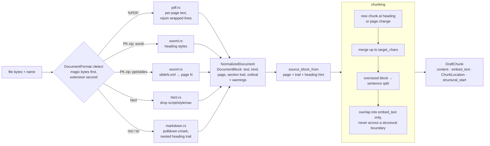

# doc-chunker

Turns PDF, DOCX, PPTX, HTML and Markdown into retrieval chunks that know where they came from: the page or slide, the full heading trail, and whether a chunk starts where the document itself starts a new idea.

## Why this exists

A chunk without a page number can be retrieved but not cited. A citation that opens in the middle of a sentence, or under the wrong heading, is barely better than none. This code was extracted from the ingestion pipeline of a production AI learning workspace, where uploaded course material has to come back as answers that link to the exact page or slide they rest on. Fixed-size byte windows retrieved well and cited badly, so chunk boundaries here follow the document's own structure first and fall back to size only when they have to.

## Architecture



The workspace has two library crates plus a thin root crate:

| crate | role |
| --- | --- |
| `document-extract` | `DocumentEngine` trait and `StandardDocumentEngine`: format detection and five extractors that output `DocumentBlock`s with page/slide and heading trail |
| `chunking` | `chunk_blocks(&[SourceBlock], &ChunkingConfig) -> Vec<DraftChunk>`, plus `ChunkLocation` (page, timestamp, line range, path, url, section) |
| `doc-chunker` (root) | `source_block_from` / `extract_and_chunk`, which bridge the two, and the `chunkprobe` CLI |

### Design decisions and tradeoffs

- **Position is never invented.** PDFs report 1-indexed pages and PPTX reports slide numbers taken from the part name (`slide12.xml` is slide 12, whatever order the zip lists it in). DOCX, HTML and Markdown report `None` instead of defaulting to page 1. A scanned PDF that parses but has no text layer produces a warning, not a "successful" empty document.
- **Content beats extension.** Downloads get renamed and exports keep the wrong suffix, so `%PDF-` and the parts inside a zip decide the format. The filename only breaks ties for text formats.
- **Structure first, size second.** A heading or page change always starts a new chunk. Small blocks merge up to `target_chars` (600 by default, about one idea). A block over `max_chars` is split at sentence boundaries, and a single runaway sentence is hard-wrapped at whitespace. The defaults are deliberately small: an embedding averages every topic in its window, so a chunk covering four concepts is close to none of them.
- **Overlap goes into the vector, not the text.** Each chunk has two strings. `content` is clean and is what readers and the model see. `embed_text` carries the previous chunk's tail, so a claim straddling a boundary can still be found from either side. Overlap is skipped when a chunk starts at a heading or page break, because bleeding the previous section into a new one makes it match questions it does not answer.
- **Extractor knowledge beats heuristics.** When the parser read real structure (Markdown `##`, HTML `<h2>`, a DOCX heading style), the block carries a heading hint and the chunker trusts it, including the full `Guide > Watering > Signs of overwatering` trail. Without a hint (plain text, transcripts) it falls back to a "short, few words, no full stop" guess. That guess is switched off for timestamped speech, where nearly every fragment would pass.
- **PDF text layers store lines, not paragraphs.** Wrapped lines are rejoined, hyphenated line breaks are repaired (`eigen-\nvalue` → `eigenvalue`), and a line counts as a heading only when it is not inside an unfinished sentence.
- **Lightweight dependencies.** OOXML is read straight from the zip with a pull parser rather than a document-model library. PDF goes through `pdf-extract`, which is pure Rust, so **no system library (PDFium, poppler) is required** and every test runs everywhere.
- **Simple sentence splitting.** A split after `.`/`?`/`!` followed by whitespace is enough: a slightly wrong boundary costs recall, not correctness, and it avoids pulling in an NLP dependency.

## Quick start

```bash
git clone <this repo> && cd doc-chunker
cargo run -- samples/plant-care.pdf
```

```text
file     samples/plant-care.pdf
format   Pdf
pages    3

BLOCKS (10)
    0 Heading   [p1 | Houseplant Care Handbook]
      Houseplant Care Handbook
    1 Heading   [p1 | Watering]
      Watering
    2 Paragraph [p1 | Watering]
      Most houseplants want the top few centimetres of soil to dry out between waterings. Pus…
  ...
    7 Heading   [p3 | Repotting]
      Repotting

CHUNKS (3)  target=600 max=1100 overlap=120 min=60
  #0   422 chars  boundary: structural         page 1  § Watering
      Watering Most houseplants want the top few centimetres of soil to dry out between water…
  #1   205 chars  boundary: structural         page 2  § Light
      Light Bright indirect light suits most foliage plants. A south-facing window can scorch…
  #2   408 chars  boundary: structural         page 3  § Repotting
      Repotting Repot when roots circle the bottom of the pot or water runs straight through.…
```

Try the other samples and the knobs:

```bash
cargo run -- samples/plant-care.md                      # nested heading trail, list items, a code block
cargo run -- samples/plant-care.html                    # <script>, <style>, <nav> dropped
cargo run -- samples/plant-care.docx                    # detected from zip contents, not the extension
cargo run -- samples/plant-care.pptx                    # slide numbers as pages
cargo run -- samples/plant-care.md --target 120 --max 200 --embed-text   # size splits + overlap in embed_text
cargo run -- samples/plant-care.pdf --json              # full NormalizedDocument + chunks as JSON
cargo run -p document-extract --example docprobe -- samples/plant-care.pptx   # extractor only
```

All samples are synthetic text about houseplant care. `plant-care.md` and `plant-care.html` were written by hand. The `.docx`, `.pptx` and `.pdf` are generated by `samples/generate.py` (`pip install python-docx python-pptx reportlab`), with fixed dates and placeholder authorship so the bytes are reproducible.

As a library:

```rust
use doc_chunker::{extract_and_chunk, ChunkingConfig};

let bytes = std::fs::read("notes.pdf")?;
let (document, chunks) = extract_and_chunk(&bytes, Some("notes.pdf"), &ChunkingConfig::default()).await?;
for chunk in chunks {
    // store chunk.content, embed chunk.embed_text, keep chunk.location for the citation
}
```

## Tests

```bash
cargo test --workspace
```

**54 tests.** None need network access, a system library or a feature flag.

- **`document-extract` — 29 unit tests** (28 from production + 1 new): magic-byte detection beating a wrong extension; refusing unidentifiable binary; HTML boilerplate removal; Markdown heading trails, code blocks and lists; DOCX heading styles and PPTX slide ordering; PDF line rejoining, hyphen repair, standalone headings; an empty extraction being detectable. The new test covers short wrapped lines on a narrow page not being read as headings.
- **`chunking` — 18 unit tests** (14 from production + 4 new): new chunks at headings and page changes; overlap kept out of stored content and never across a heading; small blocks merging; oversized blocks splitting with their page intact; transcript timestamps pointing at where the chunk began; spoken fragments not becoming headings; folded sub-documents keeping their path and url. New: an extractor's heading hint overriding the guess, a deep heading trail surviving, and two regressions for the heading fix described below.
- **7 integration tests** (`tests/samples.rs`): every sample file, end to end, with exact assertions on pages, slide numbers, section trails, boundary types and overlap placement.

## Changes from the extracted code

Two behaviours changed during extraction. Both are covered by the new tests above.

1. **A heading could be silently dropped.** With the default 600-character target, a heading followed by a paragraph of about 590 characters tripped the size rule. The heading was flushed alone, fell under `min_chars` and disappeared. The paragraph then started a size-boundary chunk with no section and with overlap borrowed from the previous section. A heading-only buffer is now never flushed by the size rule, and when the next block is oversized the heading leads its first piece.
2. **The heading hint is new.** In production, block kind and heading trail were not passed from the extractor to the chunker (only the page was), so the chunker re-guessed headings from text. `SourceBlock::heading: Option<bool>` defaults to `None`, which keeps the old behaviour exactly; `source_block_from` fills it in.

The narrow-page PDF fix (an unfinished sentence cannot contain a heading) was found by the generated A5 sample.

## What was left out

In production, the chunks feed an embedding and indexing service backed by Postgres and pgvector, uploads arrive through a job queue, and the same chunker also takes video transcripts (hence the timestamp handling) and pages synced from note-taking apps (hence `within_document`). Those pieces depend on the product's storage schema, workers and provider integrations, so they are not included. What remains is the format detection, the five extractors, the chunker and a CLI that shows exactly what each one produces. OCR for scanned PDFs was never part of this layer: it reports the gap as a warning and leaves the decision to the caller.
